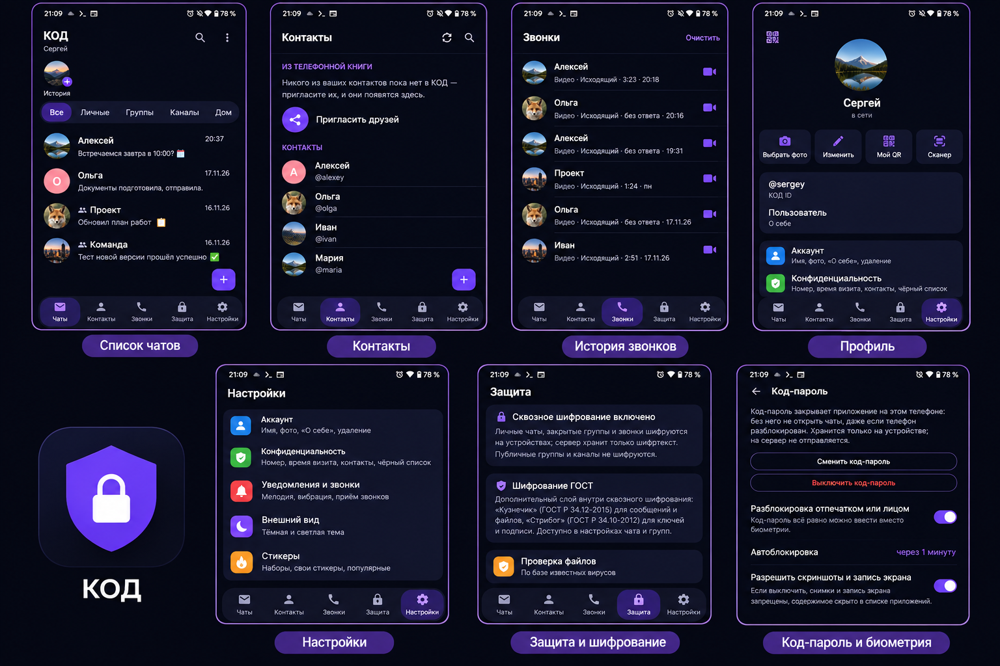

# КОД | KOD Messenger

Общение. Конфиденциальность. Контроль.

Независимый мессенджер для Android с собственной серверной инфраструктурой.

## Возможности

- Личные и групповые чаты, каналы, истории.
- Голосовые и видеозвонки, обмен файлами.
- Настройки конфиденциальности, код-пароль, биометрия и управление скриншотами.
- Сквозное шифрование в поддерживаемых чатах; публичные группы и каналы не имеют сквозного шифрования.
- Светлая и тёмная темы.

## Скачать

Официальные сборки: [Releases](../../releases). Android 8.0 или новее. Первый публичный APK готовится к выпуску.

## Интерфейс

Демонстрационный обзор интерфейса на основе версии 1.4.2. Имена, аватары и сообщения вымышлены. Изображение отредактировано; отдельные детали могут отличаться от приложения.

## Развитие

[Направления развития](ROADMAP.md).

[Официальный сайт](https://kod.degalo.ru) · [Конфиденциальность](https://kod.degalo.ru/privacy) · [Условия](https://kod.degalo.ru/terms)

## English

KOD is an independent Android messenger with private and group chats, channels, calls, file sharing and privacy controls. End-to-end encryption is available in supported chats; public groups and channels are not end-to-end encrypted. Official builds will be published in [Releases](../../releases). Android 8.0 or later.

This repository is for official binary distribution. Client and server source code are not published. Third-party components retain their respective licenses.
